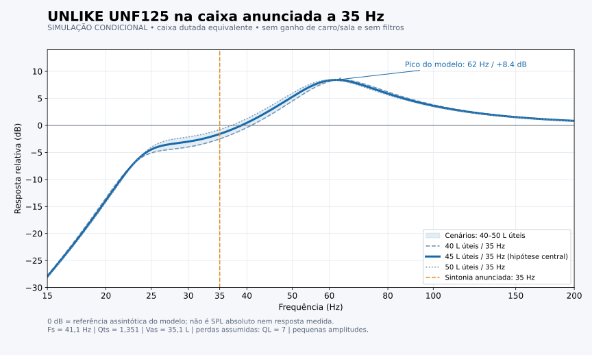
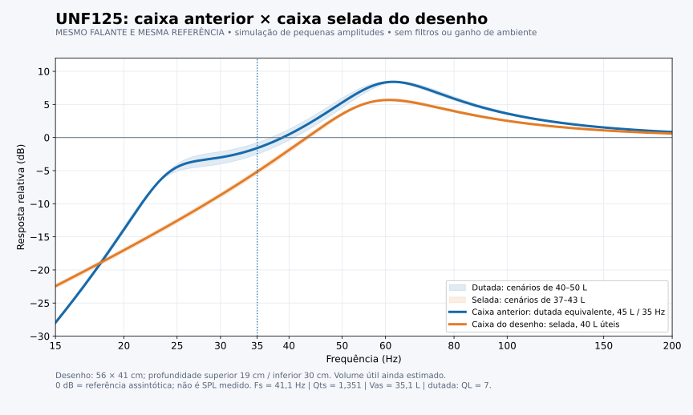
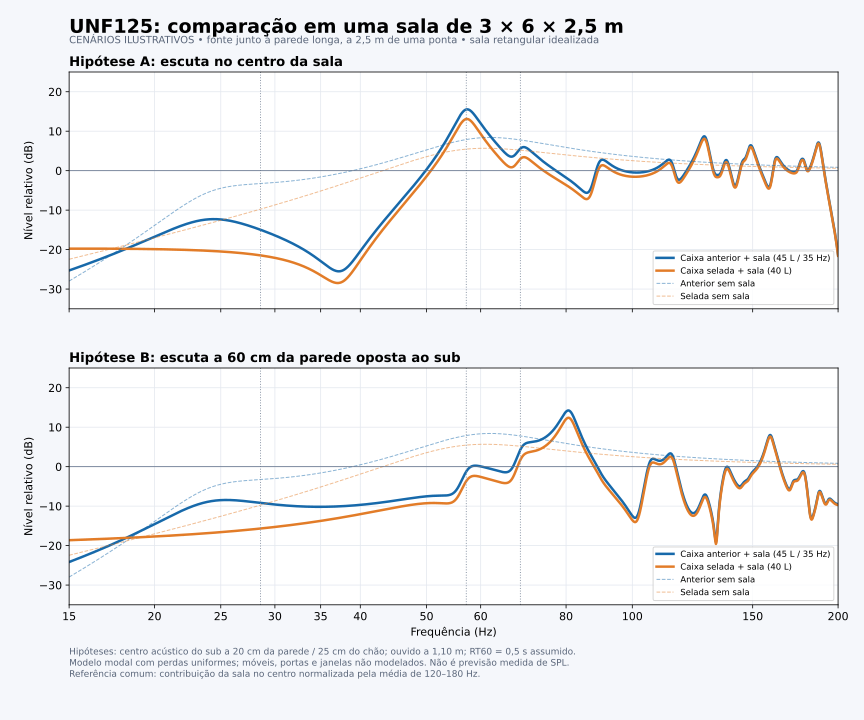
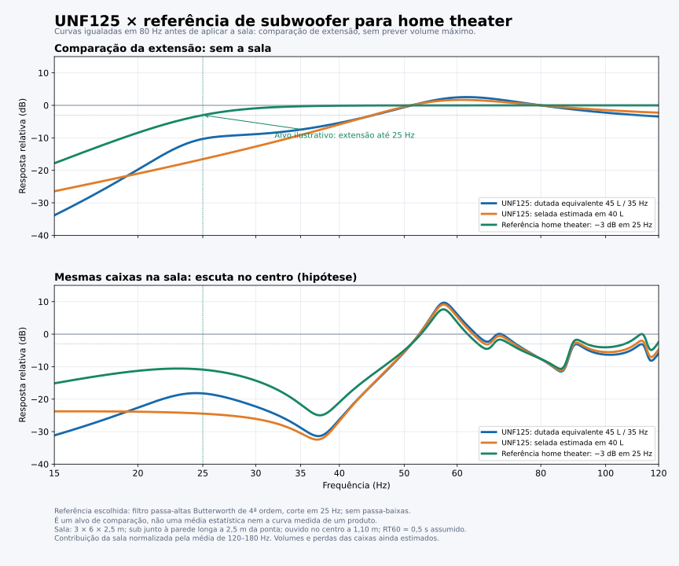

# Equidade de frequências sub-grave

Registro de estudo e conversa de 13/10/2026. Conjunto: UNLIKE UNF125 12 polegadas, 200 W, assumido como bobina dupla 4+4 ohms ligada em paralelo (2 ohms).

## Natureza dos resultados

Os gráficos são simulações condicionais de pequenas amplitudes, não medições do sistema instalado. Não demonstram SPL máximo, distorção, potência admissível por frequência nem excursão do cone. Os volumes úteis, a sintonia real e as perdas das caixas não foram medidos. A caixa anunciada como labirinto foi aproximada por uma caixa dutada concentrada; uma linha de transmissão real exige a geometria interna e outro modelo.

A referência home theater de 25 Hz foi escolhida para comparação: NÃO é uma média estatística do mercado nem uma norma de desempenho. O efeito da sala também é hipotético: posição de escuta e absorção reais não foram informadas.

## Dados do falante e caixas

Ficha oficial: Fs 41,1 Hz, Qts 1,351, Vas 35,1 L, Qes 2,02, Qms 4,08, Xmax 9,5 mm. Ligação das duas bobinas em paralelo pressupõe ambas operando; a forma de resposta ideal não muda simplesmente por passar de série a paralelo, embora tensão, corrente e impedância mudem.

| Caixa | Dados conhecidos | Hipótese usada |
|---|---|---|
| Anunciada como labirinto/dutada | 33 × 60 × 35 cm externos; 69,3 L externos; sintonia declarada 35 Hz | 45 L úteis; cenários 40–50 L; Fb 35 Hz; QL 7 |
| Selada do desenho | Medidas confirmadas: 56 cm largura, 41 cm altura, profundidade superior 19 cm e inferior 30 cm | 56,3 L externos; madeira 15–18 mm e deslocamentos estimados; 40 L úteis; cenários 37–43 L |

69,3 L e 56,3 L são volumes externos, não o volume acústico líquido. A ficha oficial também apresenta uma sugestão de caixa de 40 L/35 Hz, o que não confirma o volume nem a geometria da caixa do anúncio.

## Resposta sem equalização e sem sala

Referência desta primeira tabela: assíntota de alta frequência do modelo, comum às duas caixas; não é dB SPL.

| Hz | Dutada 45 L / 35 Hz | Selada 40 L |
|---|---:|---:|
| 20 | −13,9 dB | −17,0 dB |
| 25 | −4,5 dB | −12,6 dB |
| 30 | −3,0 dB | −8,7 dB |
| 35 | −1,6 dB | −5,2 dB |
| 40 | +0,5 dB | −1,9 dB |
| 50 | +5,3 dB | +3,5 dB |
| 60 | +8,3 dB | +5,7 dB |
| 80 | +5,9 dB | +4,0 dB |
| 100 | +3,6 dB | +2,5 dB |

Picos do modelo: dutada aproximadamente 62 Hz / +8,4 dB; selada aproximadamente 61 Hz / +5,7 dB. Portanto, sintonia de 35 Hz não significa pico acústico em 35 Hz. Ambas reproduzem 35 Hz, com intensidades diferentes.

## Sala informada e posição

Medidas finais informadas pelo usuário: 3 × 6 × 2,5 m = 18 m² e 45 m³. O sub está junto à parede de 6 m, aproximadamente a 2,5 m de uma ponta, apontado para o centro.

Hipóteses adicionais: centro acústico do sub a 20 cm da parede e 25 cm do chão; ouvido a 1,10 m; RT60 uniforme de 0,5 s; sala retangular idealizada com perdas uniformes. Duas posições de escuta ilustrativas: centro (1,5; 3; 1,1 m) e a 60 cm da parede oposta (2,4; 3; 1,1 m). Não são posições confirmadas do usuário.

Primeiros modos axiais: 28,6 Hz no comprimento, 57,2 Hz na largura e 68,6 Hz na altura. Há outros modos, inclusive sobreposição em 57,2 Hz pelo comprimento. Suas frequências não garantem reforço audível: posições determinam acoplamento, interferências e cancelamentos.

O gráfico aplica uma função de transferência modal de fonte pontual ao resultado das caixas, sem modelar separadamente cone/duto nem o carregamento acústico de retorno sobre o falante. Usa c=343 m/s e modos até 1400 Hz. A contribuição da sala foi normalizada pela média de 120–180 Hz na posição central, com a mesma referência nas outras curvas. Os picos e vales exatos são ilustrativos e não devem orientar filtros diretamente. Portas, janelas, móveis e absorção real não foram medidos.

## Referência de home theater

Exemplos oficiais consultados: Polk PSW10 com limites −3 dB de 40–160 Hz; SVS SB-1000 Pro selado com 20–270 Hz ±3 dB; SVS PB-1000 Pro dutado com 17–260 Hz ±3 dB. Não foram comparados SPL máximo, distorção ou medições nas mesmas condições.

Alvo ilustrativo adotado: passa-altas Butterworth de quarta ordem com −3 dB em 25 Hz, quase plano acima de 30 Hz, sem passa-baixas. A comparação foi exibida até 120 Hz. Todas as caixas foram igualadas em 80 Hz ANTES de aplicar a sala. Isso compara extensão relativa, não eficiência absoluta; os números desta tabela não usam a referência da tabela anterior.

| Hz | Dutada igualada em 80 Hz | Selada igualada em 80 Hz | Alvo HT |
|---|---:|---:|---:|
| 20 | −19,7 dB | −21,0 dB | −8,4 dB |
| 25 | −10,3 dB | −16,6 dB | −3,0 dB |
| 30 | −8,9 dB | −12,7 dB | −0,9 dB |
| 35 | −7,5 dB | −9,1 dB | −0,3 dB |
| 80 | 0 dB | 0 dB | 0 dB |

A dutada melhora a saída de 25–35 Hz neste modelo, mas não garante extensão intensa até 20 Hz. Uma selada pode ter resposta profunda se o conjunto falante/caixa/amplificação/DSP for projetado para isso; ser selada não é, por si só, impedimento.

## O que o DSP pode corrigir

Ambas as caixas aceitam equalização. Cortar picos torna os graves baixos mais presentes em relação aos altos, sem elevar sua saída real. Reforçar graves baixos exige tensão, corrente, margem digital e excursão disponíveis. Abaixo da sintonia de uma dutada, grandes reforços são especialmente limitados pela excursão. Cancelamentos profundos da sala devem ser tratados primeiro por posicionamento, não por grandes boosts.

Diferença de 3,6 dB em 35 Hz, com a mesma excitação do modelo, corresponde a aproximadamente 51% mais pressão sonora. Não corresponde a 51% mais volume percebido. A estimativa de 28% de aumento subjetivo citada na conversa usa a regra grosseira de duplicação a cada 10 dB; NÃO é uma previsão confiável para um tom de 35 Hz em nível desconhecido.

Com as curvas igualadas em 80 Hz, o esforço para alcançar o alvo foi estimado assim:

| Hz | Boost selada | Boost dutada | Menor tensão necessária na dutada |
|---|---:|---:|---:|
| 20 | +12,6 dB | +11,3 dB | aproximadamente 14% |
| 25 | +13,6 dB | +7,3 dB | aproximadamente 52% |
| 30 | +11,8 dB | +8,0 dB | aproximadamente 35% |
| 35 | +8,8 dB | +7,2 dB | aproximadamente 17% |
| 40 | +5,8 dB | +5,3 dB | aproximadamente 6% |

Fórmula: redução relativa de tensão = 1 − 10^(−diferençaDeBoost/20). Essa tabela NÃO prescreve filtros, não demonstra viabilidade física dos boosts e não é uma porcentagem de redução de excursão. A potência real depende da impedância por frequência; equivalências de potência pressupõem impedância fixa. Cortar outras bandas pode evitar boost positivo, mas reduz o nível geral disponível para manter o equilíbrio.

## Recursos confirmados no código do A34

Na branch padrão consultada no GitHub, o AudioProfile/DspEngine implementa nove filtros paramétricos exclusivos do LFE: frequência 10–200 Hz, ganho −12 a +6 dB, Q 0,3–10. O motor aplica esses filtros ao LFE depois de somar os graves encaminhados por outras caixas. O EQ geral tem dez bandas e atua nos seis canais, sendo diferente do EQ exclusivo do sub.

O perfil padrão contém frequências 20, 25, 30, 40, 50, 60, 80, 100, 120 Hz; ganhos +6, +6, +6, +5,5, +1,5, −4, +1, +1, −2,5 dB; Q 2. O perfil salvo no aparelho pode ser diferente. Os gráficos deste estudo NÃO incluem esse perfil: foram calculados sem EQ e sem filtros eletrônicos.

A margem automática do LFE considera a soma dos ganhos positivos e as fontes de graves somadas. Ela pode reduzir bastante o nível global do sub. A correção de headroom do EQ geral descrita na 0.9.1 não deve ser confundida com essa regra específica do LFE. O subsônico LFE é opcional e sua configuração ativa precisa ser consultada.

A versão 0.10.0/controle A55 0.2.0 documenta medição assistida em três posições, propondo apenas cortes conservadores, até −6 dB e Q 3, para picos repetíveis. O relatório consultado registrava instalação e validação acústica pendentes; esta consulta não verificou versões nos aparelhos nem modificou perfis.

## Relato de campo em 24 Hz e pendência

O usuário esclareceu: em um teste de 24 Hz na caixa selada, o cone não apresenta movimento visível. Isso é uma observação do usuário, não medição de excursão. Não atribuir a ausência de movimento visível automaticamente à caixa, ao falante ou a um filtro específico.

Pendências: identificar como o tom é gerado; comparar com 40 Hz no mesmo volume; conferir perfil ativo, subsônico, margem LFE, rota e nível de sinal; verificar eventual atenuação no amplificador/fonte. A caixa selada não bloqueia, por si só, o movimento em 24 Hz. Pouco nível acústico também não permite concluir pouca excursão.

Nenhuma configuração foi aplicada ao A34 durante este estudo. Antes de definir filtros reais, medir a resposta no ponto de escuta e conferir os limites do conjunto.

## Arquivos e reprodução dos cálculos

- Gráficos vetoriais SVG: resposta-unf125.svg, comparacao-dutada-selada.svg, comparacao-na-sala.svg e comparacao-home-theater.svg.
- CSVs correspondentes: frequências e dB relativos; cada arquivo conserva sua referência descrita acima.
- Scripts: simular.py, comparar.py, comparar_sala.py, comparar_home_theater.py. Requerem Python, NumPy e Matplotlib. Executar na pasta em que foram salvos; também geram PNGs localmente.
- Executar python comparar_home_theater.py reproduz a comparação HT e, por dependência, a comparação com a sala. Os outros scripts reproduzem as primeiras curvas. Os scripts conservam hipóteses e referências do estudo.

## Fontes

- [Ficha oficial UNF125](https://unlikealtofalantes.com.br/standard/img/downloads/manuais/UNF125.pdf)
- [Produto UNF125](https://unlikealtofalantes.com.br/9/subwoofer-12-200w-rms-44/)
- [Caixa anunciada no Mercado Livre](https://www.mercadolivre.com.br/caixa-labirinto-12-para-graves-pesado/p/MLB2083263795) — página não pôde ser lida; dimensões e sintonia vieram da descrição fornecida pelo usuário.
- [Polk PSW10](https://www.polkaudio.com/en-us/product/home-speakers/psw-10/112479-new.html)
- [SVS SB-1000 Pro](https://www.svsound.com/products/sb-1000-pro-subwoofer)
- [SVS PB-1000 Pro](https://www.svsound.com/collections/ported-subwoofers)
- [COMSOL: desempenho de caixas em salas](https://cn.comsol.com/support/learning-center/course/modeling-speaker-performance-in-a-room-402/using-fem-to-model-speaker-room-performance-132522)
- [Percepção de volume — UC San Diego](https://musicweb.ucsd.edu/~trsmyth/loudness175/What_s_Twice_as.html)
- [miniDSP: headroom e clipping com EQ](https://support.minidsp.com/support/solutions/articles/47000681666-why-do-i-get-distortion-when-i-turn-on-dirac-live-)
- [AudioProfile do A34](../../android-a34/app/src/main/java/br/com/sistema51/a34/dsp/AudioProfile.java)
- [DspEngine do A34](../../android-a34/app/src/main/java/br/com/sistema51/a34/dsp/DspEngine.java)
- [Relatório de correção de sala](../ATUALIZACAO-AC3-ESTEREO-CORRECAO-DE-SALA-2026-10-10.md)
